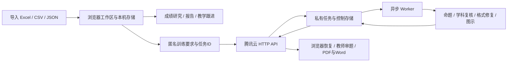

# 荣县第一中学高三成绩分析

面向教师的成绩研究、教学跟进与个性化辅导工作区。以导入的成绩表、小题得分和有效线为依据，从年级、班级、试卷追踪到学生，保存研究证据与教师判断，再生成、审阅和导出专项练习，形成后续训练与复核记录。

成绩研究在浏览器本机完成；需要 AI 出题时，由专属腾讯云服务接收匿名训练要求并执行任务。前端使用原生 JavaScript 和静态资源，部署在 GitHub Pages。

| 入口 | 用途 |
| --- | --- |
| [正式工作区](https://yusheng266186-beep.github.io/jianwei-observatory/) | 导入材料，开展成绩研究、打印报告与教学跟进 |
| [模型工作台](https://yusheng266186-beep.github.io/jianwei-observatory/model-workbench.html) | 教师验证后管理官方账号、模型、思考强度、配图服务、次数与运行记录 |
| [学科图示库](https://yusheng266186-beep.github.io/jianwei-observatory/figure-library.html) | 查看学科图示类型、覆盖范围与绘制示例 |
| [文档总索引](docs/README.md) | 查阅架构、部署手册、专题说明和历次验证记录 |

**当前维护方式：直接维护主仓库 `main` 并发布正式站。** 历史预览站保留用于旧资料迁移，不再作为日常更新入口。工作台已统一使用云端 OpenAI OAuth 账号通道，原“现有计划通道”已退出界面与公开模型目录。当前状态说明更新于 **2026-10-22**，具体维护证据见[工作台整合与实测](docs/WORKBENCH-UNIFIED-2026-10-22.md)。

## 阅读导航

- [功能概览](#features)
- [教师使用指南](#teacher-guide)
- [统计口径与数据保存](#data)
- [个性化辅导与模型管理](#training)
- [系统架构与目录](#architecture)
- [本地开发](#development)
- [测试与验证](#testing)
- [发布与维护](#deployment)
- [常见问题](#faq)
- [文档与维护约定](#documentation)

<a id="features"></a>
## 功能概览

### 六个研究入口

| 入口 | 可以完成的工作 |
| --- | --- |
| 年级总览 | 查看本场概况、重要表格、班级与科类比较、有效账、阶段线索和学生清册 |
| 班级研究 | 研究学科剖面、双上线与临界名单、历次变化、逐人矩阵及班级教学任务 |
| 试卷研究 | 按实际题号查看得分率、知识点、班级与学生作答矩阵，追踪单题证据 |
| 学生研究 | 按姓名等条件检索、选择考次、查看完整阶段线索、学科与小题表现，收藏或比较2–4名学生 |
| 教学跟进 | 进入个性化辅导，管理临界发现、行动看板、训练日程、练后反馈和再测 |
| 资料与报告 | 管理材料、备份、有效线、题目资料和统计口径，使用试题中心、打印报告及证据报告 |

### 研究留存与文档输出

- **研究夹**保存检索条件、考次、展开状态、页面和长表阅读位置、观察窗上下文；再次打开时按当前材料查询。
- **证据摘录**保存当时的结果快照与教师判断，后续筛选不会改写原证据；导出全部摘录不受当前列表筛选影响。
- **浏览器返回与刷新恢复**保留各条研究路径自己的条件与位置，材料更换后隔离不再适用的旧上下文。
- **报告与导出**覆盖班级、学科、学生、教学跟进报告，以及学生练习和教师答案。支持 PDF、可编辑 Word、相关表格的 Excel 导出，以及图表 SVG/PNG 导出。

报告和练习采用统一的宋体纸面风格；公式、表格、图示、关键数据和作答留白分别处理。预览中的分页或列表截取不应缩减完整导出范围。

<a id="teacher-guide"></a>
## 教师使用指南

### 1. 导入或恢复材料

首次打开会显示可直接操作的导入首页。选择文件或拖入材料，支持 `.xlsx`、`.xls`、`.csv` 和本项目导出的完整 `.json` 备份。

- 原有专用工作簿按已核实的表结构解析；通用 Excel/CSV 可在映射界面调整列的对应关系。
- 已有资料时，可选择合并补充或替换。合并会关联学生、考次、班级、学科与题号；替换前保留可撤回快照。
- 遇到重复记录或来源冲突，先确认采用哪份来源，再加入工作区。
- 查看导入摘要中的学生、考试、成绩和小题记录数量，确认后再开展研究。
- 不支持的文件会给出提示；不能只修改扩展名来代替真正的格式转换。
- 本机存储暂时不可读时会显示重新读取入口，已保存材料保留，不把读取失败当作空工作区。

### 2. 从问题进入研究

先确定研究对象与考次，再逐层追踪证据。例如：

1. 在年级总览找到需要关注的班级或学科。
2. 进入班级研究，查看薄弱学科、临界学生及历次变化。
3. 从学生或试卷研究追踪到具体知识点与题目。
4. 将关键结果保存到研究夹或证据摘录，并补充教师判断。

各研究入口分别保存自己的条件，切换页面不会把所有入口强行改成同一个筛选。趋势图保留实际零值和缺失断点，低得分率使用较深的关注色阶。

### 3. 安排教学跟进

在教学跟进中建立训练或复核安排，选择实际日期、时间与对象，记录实施情况和练后反馈。“今天／本周”同时考虑训练和复核日期；同日安排合并呈现，跨日安排分别保留。

计划状态、教师备注、实际得分与复核结论各自保存，不能仅凭日期或低分推断已经完成训练、存在何种错因。

### 4. 生成专项练习

进入 **教学跟进 → 个性化辅导**，可以直接检索全年级学生，再选择对应学科与考试依据。按页面顺序确认教学范围、知识点、训练重点、题型、难度、题量、时长及补充要求，最后在“生成前核对”检查本次选择。

设置支持自动暂存草稿、保存为教学模板，以及从历史练习沿用。更换学生或学科时，草稿与真实考试依据分别保留，避免把上一名学生的依据误套给下一名学生。

需要云端生成时，使用认证器中的教师动态验证码；网页不要求填写上游 API 密钥或服务地址。

### 5. 在试题中心审阅与导出

进入 **资料与报告 → 试题中心**，查看已生成和正在执行的任务，按班级、学科或状态检索、筛选与整理。

1. 生成中可查看当前阶段、已用时间、预计时间和上游实际返回的内容。
2. 生成完成后，核对题干、答案、解析、评分、图示及教学范围。
3. 需要时修改内容或拖动调整图片大小，再确认当前文档版本。
4. 导出学生练习或教师答案的 PDF、Word，或将练习加入教学跟进。
5. 练后记录结果、教师备注与再测安排；不再需要的任务可删除，按界面提示撤销。

已接收的任务在云端执行，关闭网页不会主动取消。重新连接时先查询原任务，未完成的题组、复核或图示可按界面提示继续；不要因为暂时没有新输出就重复点击生成。

### 6. 备份与换设备

定期在资料与报告中下载**完整 JSON 备份**。换设备、换浏览器、清理网站数据或使用另一域名之前，先备份，再在新环境导入。

完整备份包含成绩、小题、教学计划、证据、收藏、研究夹、练习及已保存模板和草稿；不包含教师登录会话、上游凭据或云密钥。云端账号管理跨设备共享，浏览器本机的材料与试题目录不会因此自动同步。

若部分本机集合暂不可读，会先导出明确标注的“当前可恢复资料”，保留当前页面可读取的材料与练习；存储恢复后再下载完整备份。

<a id="data"></a>
## 统计口径与数据保存

### 以原表为依据

| 情况 | 处理原则 |
| --- | --- |
| 空白与真实0分 | 空白保留缺失；0是有效数值，参与统计和合并更新 |
| 原分与赋分 | 分别保存，不把某一类分数缺失补成另一类 |
| 班排、校排、市排 | 保留明确来源和范围，不用班排冒充校排，不从不完整导入范围重算校排 |
| 通用表格排名列 | 自动识别“原分市排名”“赋分校排名”等明确表头；同范围多列默认赋分优先，其次通用、再其次原分，映射时可调整，不逐行拼接空值 |
| 满分或有效线缺失 | 不补造得分率、失分或达线结论；“—”与真实0人分别显示 |
| 知识点缺失 | 不凭得分臆测标签，需结合原题补充；不同考试的同题号不自动认定为同一道题 |
| 跨考比较 | 按选定考次和可比较范围分析，不直接混算不同科类或统计范围的名次 |
| 材料合并 | 空白保留已有值，0可更新；成绩变化使未同步提供的对应排名失效 |

专用工作簿中的特殊班级、科类、外语投影和历史表头适配保留在解析与测试中。调整这些规则应核对实际原表，详见[当前架构中的数据与来源](docs/ARCHITECTURE.md#数据与来源)。

### 本机与云端分别保存什么

| 位置 | 保存内容与边界 |
| --- | --- |
| 浏览器本机 | 原始成绩、学生身份、教师判断、教学计划、练习目录、草稿、研究条件及预计算缓存 |
| 云端任务区 | 匿名训练参数、生成进度、成稿、图示及必要诊断；当前任务前缀采用14天保留规则，应及时审阅、保存和导出 |
| 云端控制区 | 教师模型配置、额度设置及加密保存的官方授权账号等控制数据，与普通任务生命周期分开 |
| 完整备份 | 本机可迁移工作资料；教师会话、API密钥、OAuth令牌和云凭据不随备份导出 |

程序构造的训练请求不包含学生姓名、班级、身份标识、排名和完整成绩。自填训练要求也应使用教学描述，避免手动加入个人身份信息。正式站与历史预览路径的本机空间隔离；二者曾共享同一专属训练服务的教师配置和额度。

<a id="training"></a>
## 个性化辅导与模型管理

### 学科与训练要求

支持语文、数学、英语、日语、物理、历史、化学、生物、政治、地理，学生界面的实际可选学科跟随导入材料。

| 设置 | 当前行为 |
| --- | --- |
| 考试依据 | 可使用选定单次考试、多次考试的共性失分，或教师自定内容；多考依据须有明确知识点与真实记录 |
| 教学范围与训练点 | 提供按学科组织的选项，也支持补充输入；训练点数量应与题量匹配 |
| 题量与时长 | 滑轮选择3–12题、5–90分钟；题量和时长需满足页面中的一致性检查 |
| 难度 | 基础起步、基础巩固、方法进阶、综合提升、拓展挑战 |
| 题型与评分 | 根据学科选择适用题型，命题和复核共同核对教师选择、分值与评分依据 |
| 配图 | 默认按题目自动判断无图、SVG或必要复杂插图；也可主动选择对应策略 |

云端前置提示词按学科和环节组织，约束四川高考课程范围、题型、分值、内容完整性与输出结构。允许原创情境和陌生材料，不把练习局限于教材原题，也不把大学或竞赛知识作为必备解题条件。

### 生成、复核与图示

题文模型直接生成约定的结构化成稿。可确定的格式问题交给模型依据原稿和具体错误局部修复；学科复核检查条件、答案与评分。需要配图时，题文先提供已知条件、图示要求与插入位置，图示环节再独立规划、绘制和核对。

常见几何、坐标、力学、电路、实验装置、分子、晶胞、细胞、遗传及地理图表使用相应的声明式图示能力；必要复杂插图调用单独选择的生图服务。浏览器不执行模型生成的任意脚本或 HTML。图片位置和尺寸进入文档版本，影响题意或题图关系的修改需要重新核对。

自动检查通过表示可以进入后续流程，**不等于教师已经确认答案和教学质量**。连接、余额、授权、格式和内容问题分开处理；失败保留已有结果，不自动跨服务换模型或从头重复付费生成。

### 模型工作台

工作台分为官方账号、模型配置、配图与额度、鹈鹕测智和历史诊断。

- **官方账号**：使用现有 ChatGPT/OpenAI 账号完成浏览器 OAuth。支持跨设备提交本次返回链接、添加/重新授权、切换当前账号、读取官方额度和手动唤醒；设备码为备用方式。
- **模型职责**：分别配置出题、图示和校检模型；图示、校检可沿用出题模型，思考强度按各型号支持范围提供。
- **配置生效范围**：应用只影响新任务。提交时冻结模型、档位、生图服务和官方账号，后续切换不改变已提交任务。
- **额度管理**：可调整应用层每日生成次数或清零。0表示应用不设每日上限，上游额度、速率与云函数时限仍然适用。
- **模型比较**：将当前选择加入鹈鹕比较，按同一要求串行比较1–8个模型。默认逐字使用 Cockpit Tools 1.3.73 的提示词，生成包含SVG的完整HTML骑车动画；支持隔离播放、放大预览、下载HTML及查看模型原文、首段输出时间、总耗时与输入/输出token。提示词可调整或恢复原版，旧SVG记录仍可查看。比较会消耗相应额度，动画表现不能代替学科能力评估。详见[原版提示词与HTML预览](docs/PELICAN-HTML-2026-10-22.md)。
- **诊断**：查看连接测试、近期配置及任务记录。服务目录或TPS快照不代表当前账号有余额，也不代表长期成功率或实时速度。

官方账号通过私有云端存储和刷新租约管理，网页不持有上游令牌。旧计划通道已停用，旧实现与私有历史记录只保留兼容及审计用途。详见[工作台整合](docs/WORKBENCH-UNIFIED-2026-10-22.md)与[后端手册](backend/README.md)。

<a id="architecture"></a>
## 系统架构与目录



GitHub Pages只提供静态前端；腾讯云HTTP函数负责验证、提交和查询，事件Worker执行耗时的模型调用。导入、整理与索引尽量在浏览器Worker中完成；研究场景、完整字体、公式和报表引擎按需加载。性能优化保留透明玻璃材质、完整内容和非线性动画，支持减少动态偏好。

| 路径 | 职责 |
| --- | --- |
| `index.html`、`app/launch.js` | 首页、启动、加载和工作区恢复 |
| `app/data/` | 文件导入、身份关联、IndexedDB与本机保存 |
| `app/engine/` | 索引、排名、研究查询、训练契约及状态规则 |
| `app/scenes/`、`app/ui/` | 六个研究入口、观察窗、报告和教师操作界面 |
| `app/io/` | Excel、PDF、Word、公式与图示输出 |
| `assets/model-workbench.js`、`assets/workbench-*.js` | 独立模型工作台、账号管理与比较界面 |
| `styles/`、`assets/`、`vendor/` | 视觉样式、字体和本地第三方依赖 |
| `app/runtime/` | 构建生成的哈希资源与运行清单，不能手工修改 |
| `backend/` | HTTP接口、异步任务、云端提示词、模型适配、授权及额度 |
| `tools/`、`tests/`、`docs/` | 构建维护工具、回归测试与项目文档 |

更详细的数据、导航、保存、导出和恢复边界见[系统架构](docs/ARCHITECTURE.md)。

<a id="development"></a>
## 本地开发

### 环境与启动

需要 Node.js **22.9或更新版本**、npm；以下静态服务器示例还需要 Python 3。

```sh
git clone https://github.com/yusheng266186-beep/jianwei-observatory.git
cd jianwei-observatory
npm ci
npm run build
python3 -m http.server 4175 --bind 127.0.0.1
```

打开 <http://127.0.0.1:4175/>。请通过HTTP服务器访问，不要直接双击HTML文件；ES Modules、Worker和文件读取需要正常的网页来源环境。

前端不需要常驻Node应用服务器。`npm ci`依据锁文件安装固定开发依赖；普通前端开发不需要读取真实学生资料或配置上游密钥。实际云端出题、工作台账号和教师验证需要已有服务配置，本机启动不会自动建立这些权限。

### 修改与构建

编辑 `app/`、`assets/`、`styles/` 中的源码后，运行 `npm run build`。页面实际引用生成的哈希文件，未经重建的源码修改可能不会出现在页面中。

构建先完成编译和入口校验，再写出资源及清单。提交时同时包含源码、受影响的入口HTML、运行清单和生成资源；不要只提交源码，也不要手工修改带内容哈希的文件。

前后端训练契约变化时，运行 `npm run package:training` 同步后端契约，再执行测试与构建。它只同步契约，**不会部署云函数**。

### 常用命令

| 命令 | 用途 |
| --- | --- |
| `npm ci` | 按锁文件全新安装开发依赖 |
| `npm test` | 运行 `tests/*.test.js` 单元与逻辑回归 |
| `npm run build` | 编译入口、Worker与共享资源，更新内容哈希及清单 |
| `npm run package:training -- --check` | 检查前后端训练契约是否一致 |
| `npm run runtime:check` | 只读检查资源保留图及待清理资源 |
| `node tools/check-release.cjs` | 核对发布入口、清单和引用资源 |
| `npm run test:smoke` | 运行当前12步浏览器冒烟流程，需另启静态服务器 |
| `npm run test:responsive` | 执行专项响应式布局检查，需按脚本要求提供浏览器环境 |
| `node tools/export-training-prompts.cjs --out /绝对路径/新的导出目录` | 导出实际编译提示词，含匿名示例，不调用模型、不读取账号密钥 |

`package.json`中还保留报告、启动、控件、动效与练习等专项脚本；各专项脚本的浏览器和服务器要求以脚本及对应维护文档为准。

<a id="testing"></a>
## 测试与验证

### 浏览器冒烟测试

保持本地静态服务器运行，在另一个终端执行：

```sh
npx playwright install chromium
AUDIT_URL=http://127.0.0.1:4175 npm run test:smoke
```

可用 `CHROMIUM_PATH` 指定已有Chromium系浏览器。该流程使用独立临时上下文与匿名材料，覆盖空首页、冲突确认与导入、六场景、观察窗返回、刷新恢复、未知满分、报告设置、Excel/Word下载、学生目录、完整备份、手机布局和资源/动画检查；不会调用真实出题服务。结果、失败截图及下载文件写入被Git忽略的 `.audit-output/`。

### CI与实际调用的区别

GitHub Actions的 `Verify install and build` 包含质量检查与两套浏览器回归：

- `quality`：全新安装、契约检查、单元测试、构建、资源检查和生成文件一致性检查。
- `browser-smoke`：分别安装Chromium、WebKit，启动静态服务器并执行12步浏览器流程，分别保留测试产物。可用 `AUDIT_BROWSER=webkit` 在具备WebKit运行依赖的环境复核同一脚本。

CI不会使用真实学生表格或生产模型凭据。涉及模型、云端授权、生图或实际文档效果的改动，还需要针对性实测，并分别记录首轮成功、恢复、内容核对和导出结果，不能用“所有单元测试通过”代替真实调用验证。

2026-10-22最新回归为1035项单元测试通过；启动与存储优化另用240份匿名练习核对试题中心、手机设置及公式预览，详见[启动与恢复优化](docs/STARTUP-RESILIENCE-2026-10-22.md)。此前真实云端HTML动画、数学3题与早期SVG比较保留为历史样本。测试数字是当次快照，发布结果以对应提交的CI和[专题验证记录](docs/README.md)为准。

<a id="deployment"></a>
## 发布与维护

### 静态前端

当前直接维护 `main` 并发布正式GitHub Pages站点；推送代码与发布完成是两个状态。提交前建议检查：

```sh
npm run package:training -- --check
npm test
npm run build
npm run runtime:check
node tools/check-release.cjs
git diff --check
```

确认生成差异符合预期后提交。发布后等待质量检查、浏览器冒烟及Pages部署完成，再核对线上HTML、运行清单和哈希资源与对应提交一致。文档整理只修改说明文件，不需要部署云端或调用付费模型。

构建保留当前版本、最近3次成功发布及7天内已登记发布的完整依赖，按JS、Worker和CSS依赖图整体清理。不要逐个删除“看起来旧”的哈希文件；发布登记与资源保留规则见[构建维护说明](docs/IMPORT-AND-BUILD-MAINTENANCE-2026-10-18.md)。

### 腾讯云后端

前端发布不会自动更新后端。正式站复用已运行的专属训练服务，函数名仍带 `-dev`，不表示它只服务预览。维护时要分别考虑代码包、环境变量、运行时层、角色、网络、触发器和私有存储。

普通后端修复优先更新现有函数代码，并在部署前备份、部署后回读核对。保留教师TOTP、会话签名、任务归属、模型配置、账号存储、代理及官方运行时层；不要用完整初始化脚本覆盖现有生产环境。具体资源、配置和流程见[后端手册](backend/README.md)与[部署维护手册](docs/DEPLOYMENT.md)。

<a id="faq"></a>
## 常见问题

| 问题 | 排查方向 |
| --- | --- |
| 首次打开只有导入首页，没有研究导航 | 空材料状态按设计展示导入入口；导入并确认材料后才展开研究工作区 |
| 学生没有校排名或知识点 | 先核对原表是否提供对应字段及列映射；缺失不会自动编造或用班排代替 |
| 换设备或换浏览器后没有资料 | 成绩与试题目录保存在本机；先从原环境导出完整JSON备份，再在新环境导入 |
| 页面修改后看不到变化 | 先重建，再核对本地端口、当前提交及页面实际引用的哈希资源；正式站还需等待Pages发布完成 |
| 验证码无效 | 核对认证器绑定、设备时间和重复使用情况；使用新的动态码，不要重新生成TOTP种子 |
| 模型工作台提示网络中断 | 分别检查网页到腾讯云的连接和云端到模型的连接，也检查本机代理；不能仅凭提示判断账号失效 |
| 生成一段时间没有新文字 | 查看任务状态、已用时间和连接反馈；估时不是终止倒计时，先查询原任务，避免重复提交 |
| 生成失败或图示失败 | 看具体的授权、余额、限流、传输、格式、内容或图示原因；保留成稿，按对应环节继续 |
| 导出按钮不可用或修改后需再次核对 | 检查必要图示、内容完整性及当前版本的审题确认，修改后重新确认当前文档 |
| 国内访问速度仍不稳定 | 首页和按需加载不能消除GitHub网络差异；当前未另建国内镜像，第三方域名也会隔离本机资料 |

<a id="documentation"></a>
## 文档与维护约定

| 文档 | 内容 |
| --- | --- |
| [文档总索引](docs/README.md) | 按主题组织全部专题、实测与历史说明 |
| [系统架构](docs/ARCHITECTURE.md) | 数据、状态、浏览器恢复、任务、图示与输出边界 |
| [部署与维护](docs/DEPLOYMENT.md) | 正式发布、云端维护、本机迁移、资源保留和回退 |
| [后端手册](backend/README.md) | 当前资源、接口、配置、授权、提示词与故障处理 |
| [工作台整合与实测](docs/WORKBENCH-UNIFIED-2026-10-22.md) | 当前账号通道、模型比较、代理更新与验证范围 |
| [提示词导出说明](docs/PROMPT-EXPORT-2026-10-21.md) | 导出范围、实际编译文本与匿名示例 |
| [用户要求与实现对应](docs/REQUIREMENTS.md) | 早期需求的实现脉络，需结合当前代码和后续记录阅读 |
| [第三方许可](THIRD_PARTY_NOTICES.md) | 本地依赖与第三方资源的许可说明 |

本README和后端手册描述当前使用方式；带日期的专题记录保留当时的实现、测试数量、失败与恢复经过。历史文档中的默认模型、预览状态和旧限制不能覆盖当前配置。

后续维护将功能变化写入相关使用章节，把日期、实测样本和故障经过写入专题文档，再补入[文档索引](docs/README.md)；不再将每轮更新日志堆到README开头。本轮整理前的[项目说明](docs/HISTORY-README-BEFORE-2026-10-22.md)与[后端说明](docs/HISTORY-BACKEND-BEFORE-2026-10-22.md)均已归档。

公开仓库保存源码、静态资源、提示词和匿名测试材料。真实学生表格、完整备份、TOTP种子、会话签名、OAuth令牌、云密钥、上游密钥及含凭据的部署包保存在仓库外的私有目录，不进入提交或公开截图。
