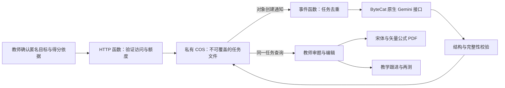

# 个性化学科练习 · 独立测试服务

当前实现单个学生的单次失分与多考共性学科训练。教师确认知识点和教材范围后生成 3–12 题，核对并编辑题干、答案、解析与评分点，输出学生练习和教师答案两份 PDF，再关联教学跟进及再测记录。原始成绩、班排和校排不参与修改。

## 使用

在学生研究中打开学生卡片，点击“生成专项练习”；也可以从教学跟进的训练编辑器进入。首次使用输入认证器中的六位 TOTP 动态码。默认连接独立的腾讯云测试服务，验证后取得七天教师会话，与 Gemini 密钥分开。动态码采用独立 Base32 种子、SHA1、30 秒步长；参照北辰允许从窗口起点起 100 秒内验证，同一动态码只能使用一次。防重放记录及每分钟十次验证上限由 COS 的不可覆盖文件在云实例间共享。原始种子只交给维护者，不进入前端或公开代码。

科目跟随学生本次考试的实际修读科目，兼容物理、历史选科及英语、日语。各学科分别保存目标草稿、匿名依据与生成历史，关联跟进时保留学科。

难度分为基础起步、基础巩固、方法进阶、综合提升、拓展挑战，题组分别约束基础、巩固与迁移的比例和范围。支持填空、单选、多选、解答、简答、阅读、写作、实验、计算和翻译；阅读材料和必要情境必须完整提供，输出仍须教师审题。

检查匿名得分依据，补充明确的知识点、教学范围、题数和训练时长，然后点击“生成专项练习”。未标知识点的得分项须由教师结合原题确认目标；系统不凭得分臆测错因。关闭弹窗或重新打开网页后可查询同一任务，不会自动重建。网络中断导致提交未确认时，“继续查询”使用原任务 ID 核对或补交。

逐题审定后勾选确认才能打印或加入跟进。任何题目修改会撤销审题确认。加入跟进先形成草稿，教师确认课时和复核安排后保存。练习随本机完整备份及关联的计划一起保存；备份不包含教师会话或 Gemini 密钥。

## 数据与运行



HTTP 函数立即返回任务 ID，出题运行在独立事件函数中。COS 的 `meta.json`、`run.json`、`result.json` 都用禁止覆盖的写入；重复通知不能重复调用模型。每日额度同样以不可覆盖的编号槽位预留，默认共享教师工作空间 30 次。后台文件保留 14 天，本机已保存练习保留至用户更换资料或恢复备份。

发送字段固定为学科、年级、教材、目标、题量、时间、难度和最多 12 个匿名有效得分项。学生姓名、班级、标识、排名及完整成绩留在浏览器。真实零分保留，缺分、缺满分及异常分不进入出题依据。

Gemini API Key 仅注入事件函数；HTTP 函数持有 TOTP 种子和独立会话签名密钥。两函数使用 SCF 执行角色的临时凭据，只能读写本服务的 COS 前缀。前端包含公开服务地址，不包含上游及腾讯云密钥。请求限定允许的网站来源，仍必须持有效教师会话。

模型、公式组件和 PDF 组件均按需加载，不进入空首页初始依赖。MathJax 3.2.2 使用本地许可文件，包含按需加载的 mhchem 化学式与单位扩展，公式导出为 SVG；打印复用现有宋体字体缓存和 PDF Worker。相邻题目中完全相同的长阅读材料按完整段落只印一次，保留原题编号、问题与答案；短题与作答区一起分页。保留原有玻璃材质、交互动画和数据预计算缓存。

## 部署（隔离的开发环境）

`tools/deploy-training.cjs` 只操作以下资源：

| 资源 | 标识 |
| --- | --- |
| 区域 | ap-chengdu |
| HTTP 函数 | jianwei-training-api-dev |
| 事件函数 | jianwei-training-worker-dev |
| 私有桶 | jianwei-training-dev-1459223409 |
| 角色 / 策略 | JianweiTrainingDevRole / JianweiTrainingDevPolicy |

部署前在仓库外准备权限为 0700 的目录，其中 `tencent.credentials.json` 是包含 `SecretId`、`SecretKey` 的 JSON，`gemini.key` 是用户授权的 ByteCat Gemini 密钥；文件权限为 0600。脚本首次生成 `training-private.json`，后续部署复用该文件以保留独立 TOTP 种子、任务归属和会话签名；首次从固定口令迁移时生成新种子并使旧口令会话失效。

```sh
node tools/package-training.cjs
TRAINING_PRIVATE_DIR=/absolute/private/directory node tools/deploy-training.cjs
```

凭据文件与部署 ZIP 始终放在仓库外。部署脚本检查桶未启用版本控制，确保禁止覆盖语义有效；等待函数更新完成后才绑定 COS 通知。部署结果记录在私有目录的 `training-deployment.json`。不改北辰现有函数、其存储、角色或正式网页分支。

本分支前端默认使用测试服务。合并之前可用 `python3 -m http.server 4175 --bind 127.0.0.1` 预览；该来源已列入测试服务允许来源，正式网页仍使用原版。

独立 Pages 预览地址为 <https://yusheng266186-beep.github.io/jianwei-observatory-preview/>。专用预览仓库通过 Actions 提取本分支的静态前端，不上传后端、测试材料或凭据，不修改正式仓库的 Pages 来源。分支更新后可在预览仓库手动重新运行部署流程。

由于两个 Pages 地址同源，预览路径使用独立的 `gemini-preview` 本机存储范围：成绩与预计算缓存、教学计划、偏好、教师会话和练习分别保存，后台 Worker 也使用同一预览范围，并跳过正式站及旧版数据迁移。试用前可从正式站下载完整 JSON 备份，再在预览站导入；它不会自动采用正式站的材料。

## 检查与范围

`node --test tests/*.test.js` 包含匿名请求边界、结构校验、并发额度、重复任务 ID、事件重放和失败信息脱敏检查。`node tests/exercise-studio.cjs` 使用模拟网络验证 UI 和打印，不消耗模型额度；可用 `EXERCISE_SAMPLE=/private/generated.json` 检查实际生成的题目版式。`AUDIT_BROWSER=webkit` 检查移动浏览器对应的渲染。

已实现格式和完整性校验以及教师审题流程；它不能代替学科正确性审定。第一阶段按教师确认的知识点训练。未标知识点的语义推断、批量生成全班练习及自动评卷尚未纳入本分支。

## 辅导中心与考试依据

教学跟进首页提供独立“个性化辅导”入口，按班级和学生进入；原学生观察窗和训练计划入口继续可用。题量支持 3–12 题（3/5/8/10/12 快捷项），时长 5–90 分钟。

出题依据分为本次考试失分、多次考试共性、教师自定目标。多考可选择 2–6 次考试，只按原表明确知识点进行精确分组，至少两考出现真实失分才列入共性。不同考试的同题号不自动配对；缺分、缺满分和异常分不纳入，零分保留。未标知识点的失分项不编造标签；分析和考试名称映射在本机完成，云端只接收匿名编号和得分、知识点汇总。

`backend/templates.cjs` 是云端统一模板，分学科设置命题规则、适用图示和复核要求，并提供薄弱点专项、同类变式、复核小测策略；前端 `/templates` 仅展示摘要，实际出题始终使用服务端模板，生成记录保存模板版本。

## 图示与复杂插图

默认优先声明式 SVG：坐标图、统计图、几何图、受力图、电路、装置和流程图。模型只返回受约束的数据，不执行模型输出的 SVG、HTML 或 CSS；浏览器统一绘制，PDF 保持矢量并给中文标签载入宋体分片。

“SVG优先，允许一张复杂插图”仅允许模型提出一张必要复杂图的说明。题目生成后仍需教师点击“生成复杂插图”，才调用独立图片任务。`POST /illustrations` 只从同一教师已有 hybrid 任务提取云端原始图示，不接受任意提示词或外部地址；同图重复点击返回同一任务，COS 通知重放不重复生图。图片任务与文字题目分开，失败不删除文字练习，不自动重试扣费；未补齐必要插图不能审题打印，可另建 SVG 版本。

生图密钥放在仓库外 `image.key`，只注入事件函数，模型固定为用户指定的 `gpt-image-2`。按该站模型详情使用 `/v1/chat/completions` 的网页版逆向生图协议；解析普通或 SSE 响应内的图片，只接受有大小限制的 PNG/JPEG，远程结果仅允许明确的中转站和 OpenAI 文件域名，拒绝重定向及其他地址，图片下载后进入私有任务及本机备份。文字与图片任务共用每天 30 次额度。该模型由中转站封装网页版逆向生图，须按中转站实际协议联调；接口错误不直接等同于模型不可用，失败仍保留题目及 SVG 方案。
