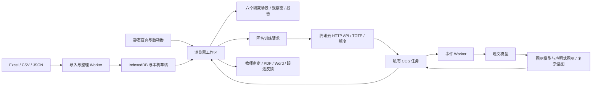

# 当前系统架构

更新于2026-10-18。正式前端、个性化辅导、模型工作台、图示库和共用后端均纳入同一源码仓库。历史设计过程见文档索引和历史架构快照，当前运行规则以本文及对应实现为准。

## 运行层次

GitHub Pages 仅提供静态前端，后端源码不会在 Pages 执行。腾讯云 HTTP 函数接收/查询任务；独立事件函数执行模型调用。正式和预览共享已部署的专属训练后端，不修改北辰运行资源。

## 启动、构建与性能

`index.html` 内含关键首页样式与轻量字体入口。`app/launch.js` 先探测本机工作区，空白时保留可操作的导入首页，有材料时并行恢复存储、索引和应用。`app/data/importer-worker.js` 接收 File，解码、列对应复用已读行；`prepare-worker.js` 处理归一化、合并及索引准备，避免主线程重复解析。

`tools/build-runtime.cjs` 用固定 esbuild 版本打包主程序、共享模块、导入/恢复线程和两个独立页面，生成内容哈希文件及 `app/runtime/manifest.json`，并更新入口 HTML。样式按明确顺序合并，后置共享控件层协调玻璃输入、滑轮和滚动条。字体、工作簿、公式和输出引擎按需加载。

Atlas 查询索引、页面、公式及导出结果分别有缓存和失效边界；数据更换、内容修改或审题版本变化不能继续使用不相符的旧结果。减少动态偏好独立于正常页面过渡；性能优化保留既有视觉与完整材料。

## 数据与来源

| 模块 | 职责 |
| --- | --- |
| `data/parser.js`、`compat.js` | 原表、平面文件及旧备份适配、归一化、去重与合并 |
| `data/identity.js`、`context.js` | 学生身份与同名处理、教师工作关联 |
| `data/storage.js`、`workspace.js` | IndexedDB、顺序写入、事务、准备版本及工作区快照 |
| `data/notes.js` | 同步判断草稿、刷新恢复和保存确认 |
| `engine/atlas.js` | 学生、考次、班级、科类、学科、试卷与作答索引 |
| `engine/ranking.js`、`data/rank-repair.js` | 明确排名范围和旧材料的来源校正 |
| `engine/research-roster.js`、`stage-comparison.js` | 一致名单顺序与可比较阶段变化 |
| `scenes/`、`ui/` | 场景组织、观察与交互，不另造原始成绩 |
| `io/` | Excel、研究报告、训练 PDF/Word、公式和图示输出 |

原分、赋分、市/校/班名次分开。源工作簿历史块有复用表头的情况，解析器仅对已核实的特定模板/考次采用来源映射；普通明确表头继续按实际字段读取。校排不从局部导入人数重算。班排名次有明确原值时优先使用，允许按实际本班本场材料呈现可计算班内位置。真实0与缺失分开；未标满分或知识点不补造。

## 状态、研究路径与恢复

六本 `books` 分别保存场景状态，不存在一个覆盖所有研究的统一全局筛选。对象路由如 `#class/4/history`、`#papers/数学%7C52`、`#people/学生标识/52`；个人完整档案保留全部阶段。渲染、导航、导入和保存使用序号/版本，丢弃迟到响应，避免旧任务覆盖新对象。

名单查询与观察窗队列共用筛选排序，上一位/下一位包含分页外实际对象；历次矩阵带入选定考次内的实际记录。研究夹保存条件、页面/表格左右上下位置、折叠区及抽屉栈，按当前材料重查。摘录保存结果快照、输出内容选择及判断，两者用途分开。

浏览器历史在 `history.state.jianweiResearch` 保存独立阅读条件、位置和最多10层返回路径，前后导航共用研究恢复流程；不包含原始成绩。导航标识随材料更新更换，刷新沿用当前材料的标识。地址与标识匹配且对象有效时才恢复；旧历史和直接链接回到常规路由解析。滚动合并写入，页面切换前同步检查点，双路由事件去重并由导航版本防止过期恢复。

DOM 协调保持输入、展开和稳定记录节点；动画生命周期释放观察器、浮层和事件。窗口顶部操作及移动端底部安全区保持可达。纸面、密度和动态偏好只改变表达，不改变统计口径。

## 本机存储边界

正式路径沿用 `hengji-evidence-workspace` 和 `hengji:` 偏好前缀；预览路径使用 `-gemini-preview` / `hengji-gemini-preview:`。Worker 与文档使用相同命名空间。正式旧版资料按原兼容逻辑恢复，预览不读取正式历史资料。

完整备份包括成绩、小题、教学计划、摘录、收藏比较、目录视图、研究夹、练习和已保存训练模板；教师登录会话、上游凭据及云密钥不在备份内。导入含练习备份时按记录ID归并；模板按归档规则合并。正式与预览不自动复制数据。

## 辅导、异步任务与图示

`exercise-contract.js` 规定匿名请求及文档结构，`package-training.cjs` 同步后端 `.mjs` 契约。教师先确认目标和考试依据，前端只传学科、范围、题量、时长、难度、题型与匿名有效证据，不传学生身份和完整成绩。

请求与 UUID 先保存本机，再提交。服务对任务、额度及事件通知使用不可覆盖对象去重；重连先查原ID。大题组按组执行，题文完成后按题预留的图示锚点进入图示规划、绘制与核对阶段。结构图使用受约束的数据绘制，不执行模型生成代码；复杂插图走独立任务。部分失败保留已完成内容，显式继续仅处理对应未完成部分。

模型工作台的配置保存在私有控制前缀，采用不可覆盖版本和预期版本检查。新任务冻结题文/图示模型、档位与凭据引用；后续切换不会改变旧任务。控制数据独立于14天任务保留规则。

上游流式正文与其实际提供的思考内容写入任务进度，前端显示真实内容、阶段、连接状态、已用时间和估时。没有内容时不伪造。错误归为连接、余额、认证、输出截断、格式/完整性或图示失败，诊断保留在私有区，公开响应只给必要原因。

## 审题、导出与练后反馈

题文、图示和审题确认视为一个文档版本，跨标签三方保存检测冲突，允许另存修改副本。导出再次保存并核对当前已审定版本，公式沿用相同 SVG/Word 数学表达及基线规则；相同输出复用缓存。图示宽度与位置进入文档，作答仅留合适空白。

练后结果与题目内容指纹绑定，教师单纯调整图示排版不抹掉原反馈；题目本身改变后需重新核对。反馈写入与关联教学计划同步，保留独立备注、再测与计划状态。

## 安全与维护

上游密钥仅在 Worker；HTTP 函数持会话签名与 TOTP 种子，通过 SCF 执行角色访问专属 COS。网站来源按完整 Origin 精确匹配，身份验证不能由 CORS 代替。正式和预览路径同源，不需新加来源；新增域名必须单独核实。

真实成绩、本机完整备份、原始诊断、凭据及部署 ZIP 不进入公开仓库。历史专题记录描述当时结果和限制，不是现在的验收结论；当前发布证据见正式合并校检文档。
