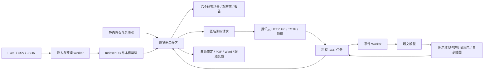

# 当前系统架构

更新于 **2026-10-22**。正式前端、个性化辅导、模型工作台、图示库和共用后端均纳入同一源码仓库。历史设计过程见文档索引和历史架构快照，当前运行规则以本文、项目/后端手册及对应实现为准。数据可靠性专题见[可靠性修复](AUDIT-REPAIRS-2026-10-19.md)，当前官方账号与模型比较见[工作台整合](WORKBENCH-UNIFIED-2026-10-22.md)。

## 运行层次

GitHub Pages 仅提供静态前端，后端源码不会在 Pages 执行。腾讯云 HTTP 函数接收/查询任务；独立事件函数执行模型调用。正式和预览共享已部署的专属训练后端，不修改北辰运行资源。

## 启动、构建与性能

`index.html` 内含关键首页样式与轻量字体入口。`app/launch.js` 先探测本机工作区，空白时保留可操作的导入首页，有材料时并行恢复存储、索引和应用。`app/data/importer-worker.js` 接收 File，解码、列对应复用已读行；`prepare-worker.js` 处理归一化、合并及索引准备，避免主线程重复解析。

`tools/build-runtime.cjs` 用固定 esbuild 版本打包主程序、共享模块、导入/恢复线程和两个独立页面，生成内容哈希文件及 `app/runtime/manifest.json`，并更新入口 HTML。`tools/style-groups.cjs` 维护唯一的主站样式顺序；三个公共包并行加载，报告阅读、试卷材质和辅导包按入口加载。链接在HTML预留原顺序，迟到的样式不追加到最终协调层后方；并发加载合并、失败可重试。字体、工作簿、公式和输出引擎按需加载。独立页面各层样式复制到原目录的内容哈希 CSS，保持字体相对路径与原有层叠顺序。详见[样式与跨端回归](STYLE-DOCUMENT-REGRESSION-2026-10-22.md)。

`tools/runtime-assets.cjs` 以当前 manifest 与 `tools/runtime-releases.json` 的成功发布依赖并集为依据，保留最近3次成功发布和7天内已登记版本。清理前校验全部保留文件及 JS 导入关系；仅删除约定目录中匹配命名规则的哈希资源，失败时不删除。发布成功回执经提交树核验后，维护者在下一轮提交前登记；构建本身不将未发布版本计为成功。旧组件加载失败显示显式刷新入口，刷新不清除本机材料。详见[维护专题](IMPORT-AND-BUILD-MAINTENANCE-2026-10-18.md)。

Atlas 查询索引、页面、公式及导出结果分别有缓存和失效边界；数据更换、内容修改或审题版本变化不能继续使用不相符的旧结果。减少动态偏好独立于正常页面过渡；性能优化保留既有视觉与完整材料。

工作区在空闲片段预热辅导模块和本机练习，空首页不启动这项工作；图示预览在实际审题时再导入。中心重复挂载合并、已读记录不无条件重复保存、输出组件分片预热。Word与Excel使用独立的可重试依赖加载器。存储读取异常与空库分开处理，附属记录不可读时可下载明确标注的当前可恢复资料，详见[启动与恢复](STARTUP-RESILIENCE-2026-10-22.md)。

## 共享视觉与交互

共享图表页头允许标题与操作按容器换行；移动长考次使用完整横向浏览栏，`ui/interactions.js` 在渲染及尺寸改变时显露选中项。报告章节与操作工具分行，训练题目使用保留全部内容的限高阅读区。共享图标由实际SVG路径绘制，布局重排立即同步选中底片几何，常规点选继续使用非线性接续动画。详见[多尺寸布局复核](RESPONSIVE-GLOBAL-2026-10-18.md)。

`styles/visual-language.css` 在主站样式合并顺序最后协调字体层级、控件、选中态、索引、观察操作及响应排列；模型工作台和图示库也引用它及同源阅读字体，CSP仅增加同源字体许可。数据色阶、报告文档版式与原统计独立。`ui/disclosure-motion.js` 共用完整details区块的可中断开关，完成后恢复自动高度；程序打开取消过时关闭，尊重减少动态与摘要内交互。普通页面不增加持续动画、外部字体或图标依赖，既有整页横移和玻璃保持。

`ui/spring-motion.js` 将临界阻尼位移采样为原生关键帧，时间轴匀速播放的是已计算的非线性轨迹。页面、Dock及标签继承中断时的位置和速度；尺寸变化只缩放高亮底片，文字维持原生尺寸。`animation-lifecycle.js` 为原生动画提供完成、取消及暂停超时回收。快速切页复用裁切视口并保留仍可见的退场DOM，结束或窗口变动时统一清理，不在动画中关闭玻璃。CSS共享阻尼曲线用于窗口、折叠与微交互，旧引擎保留三次贝塞尔回退；没有常驻逐帧JS动画循环。

## 数据与来源

| 模块 | 职责 |
| --- | --- |
| `data/parser.js`、`compat.js` | 原表、平面文件及旧备份适配、归一化、去重与合并 |
| `data/identity.js`、`context.js` | 学生身份与同名处理、教师工作关联 |
| `data/storage.js`、`workspace.js` | IndexedDB、顺序写入、事务、准备版本及工作区快照 |
| `data/notes.js` | 同步判断草稿、刷新恢复和保存确认 |
| `engine/atlas.js` | 学生、考次、班级、科类、学科、试卷与作答索引 |
| `engine/ranking.js`、`data/rank-repair.js` | 明确排名范围和旧材料的来源校正 |
| `engine/research-roster.js`、`stage-comparison.js` | 一致名单顺序与可比较阶段变化 |
| `scenes/`、`ui/` | 场景组织、观察与交互，不另造原始成绩 |
| `io/` | Excel、研究报告、训练 PDF/Word、公式和图示输出 |

原分、赋分、市/校/班名次分开。源工作簿历史块有复用表头的情况，解析器仅对已核实的特定模板/考次采用来源映射；普通明确表头继续按实际字段读取。校排不从局部导入人数重算。班排名次有明确原值时优先使用，允许按实际本班本场材料呈现可计算班内位置。真实0与缺失分开；未标满分或知识点不补造。

## 状态、研究路径与恢复

研究条件通过 `researchHistoryConditions` 在更新时即时写入本条历史，复用最后阅读位置，不进行DOM测量；完整滚动检查点保持延后合并。`researchStudySnapshot` 仅在当前板块及地址与绘制快照一致时采集最新条件。研究夹 `studyQueries` 共用完整检索词与精简摘要，保留旧名称，避免隐藏视图条件混入描述。详见[即时筛选与研究线索找回](WORKSPACE-RESUME-2026-10-18.md)。

六本 `books` 分别保存场景状态，不存在一个覆盖所有研究的统一全局筛选。对象路由如 `#class/4/history`、`#papers/数学%7C52`、`#people/学生标识/52`；个人完整档案保留全部阶段。渲染、导航、导入和保存使用序号/版本，丢弃迟到响应，避免旧任务覆盖新对象。

名单查询与观察窗队列共用筛选排序，上一位/下一位包含分页外实际对象；历次矩阵带入选定考次内的实际记录。研究夹保存条件、页面/表格左右上下位置、折叠区及抽屉栈，按当前材料重查。摘录保存结果快照、输出内容选择及判断，两者用途分开。

`engine/plot-scale.js` 共用趋势图刻度和指标单位，依据数值范围选择步长及小数位；人数、排名、百分比、相对位置和分差分别处理。零值有效、缺失断线，刻度边界不裁掉异常超界的有效数值。`Atlas.summary` 的临界人数在无可判定记录时返回null，页面显示“—”，导出保留空值；实际零人仍返回0。图表单位直接进入SVG，响应布局和图片导出使用同一份内容。

浏览器历史在 `history.state.jianweiResearch` 保存独立阅读条件、位置和最多10层返回路径，前后导航共用研究恢复流程；不包含原始成绩。导航标识随材料更新更换，刷新沿用当前材料的标识。地址与标识匹配且对象有效时才恢复；旧历史和直接链接回到常规路由解析。滚动合并写入，页面切换前同步检查点，双路由事件去重并由导航版本防止过期恢复。

DOM 协调保持输入、展开和稳定记录节点；动画生命周期释放观察器、浮层和事件。窗口顶部操作及移动端底部安全区保持可达。纸面、密度和动态偏好只改变表达，不改变统计口径。

## 教学跟进日程

`engine/training.js` 的 `planAppointments` 将教师训练与复核日期投影为安排，`planMatchesTime`、`planAgenda` 和卡片标签共用判断；不从训练日期推算复核日期。有效实测（包括0分）或复核结论解除未复核逾期提示，教师状态独立保留。日期筛选按计划计数，日期组按安排计数，同日合并、跨日保留引用。`comparePlanSchedules` 统一页面与报告训练排序，已知时刻按分钟排列，未定时刻按时段/课节排列。跨日卡片使用独立动画键，备注同步到相同计划的其他可见实例。中国时区的日期缓存键、午夜定时、焦点/可见性检查保持今天与本周更新，仅日期实际改变时重绘。

## 本机存储边界

正式路径沿用 `hengji-evidence-workspace` 和 `hengji:` 偏好前缀；预览路径使用 `-gemini-preview` / `hengji-gemini-preview:`。Worker 与文档使用相同命名空间。正式旧版资料按原兼容逻辑恢复，预览不读取正式历史资料。

成绩保存通过同事务的prepared版本比较，防止旧标签页覆盖较新材料。判断与计划使用记录/字段三方合并，同字段冲突保留本页副本；同步文字日志配合延迟完整保存，保护最后输入而避免逐键复制整份报告。

完整备份包括成绩、小题、教学计划、摘录、收藏比较、目录视图、研究夹、练习、已保存训练模板及自动暂存草稿（含考试依据和自填重点）；教师登录会话、上游凭据及云密钥不在备份内。导入含练习备份时保留较新本机题文、审题与反馈，不同旧版本保留幂等副本；草稿按合并后的学生身份映射。模板按归档规则合并。正式与预览不自动复制数据。

## 辅导、异步任务与图示

`exercise-contract.js` 规定匿名请求及文档结构，`package-training.cjs` 同步后端 `.mjs` 契约。教师先确认目标和考试依据，前端只传学科、范围、题量、时长、难度、题型与匿名有效证据，不传学生身份和完整成绩。

请求与 UUID 先保存本机，再提交。服务对任务、额度及事件通知使用不可覆盖对象去重；重连先查原ID。大题组按组执行，题文完成后按题预留的图示锚点进入图示规划、绘制与核对阶段。结构图使用受约束的数据绘制，不执行模型生成代码；复杂插图走独立任务。部分失败保留已完成内容，显式继续仅处理对应未完成部分。

模型工作台的配置保存在私有控制前缀，采用不可覆盖版本和预期版本检查。新任务冻结题文/图示模型、档位与凭据引用；后续切换不会改变旧任务。控制数据独立于14天任务保留规则。

任务状态超出单响应预算时，认证后的trace和图像分件接口保留完整内容，超长trace分段哈希检查避免混合不同快照。

上游流式正文与其实际提供的思考内容写入任务进度，前端显示真实内容、阶段、连接状态、已用时间和估时。没有内容时不伪造。错误归为连接、余额、认证、输出截断、格式/完整性或图示失败，诊断保留在私有区，公开响应只给必要原因。

## 官方账号与模型比较

工作台当前以 `openai-codex` 管理云端OAuth账号，浏览器登录为默认方式，支持跨设备回传本次返回链接、切换账号、额度与唤醒。旧计划通道不再挂载界面或进入公开目录，历史实现仅供兼容与审计。

HTTP提交时把出题、图示和修复职责绑定到同一份当前账号快照；后续切换账号不会改变已接受任务。`codex-completion.cjs` 通过账号租约调用 `codex-runtime.cjs`，同账号刷新链串行保护，轮换结果先保存再释放；占用时在发送请求前等待，不重复命题或暗中更换账号。官方运行时与私有回环代理由云端层和专门配置提供，普通代码部署保留这些运行条件。

`pelican.cjs` 管理1–8个模型的同题HTML动画比较，串行派发独立任务并保存候选、成稿及实际统计。`pelican-prompt.json` 记录 Cockpit Tools 1.3.73 原版提示词、交付指令、来源和哈希；新任务直接发送原文并冻结版本，不混入练习JSON约束。浏览器通过 `pelican-preview.html` 和双层无同源权限的沙箱保留HTML、CSS、JavaScript及SVG动画，禁止模型预览联网，支持放大与原稿下载；工作台主文档不启用内联脚本。旧SVG结果和模型原文仍可读取，最近比较可从云端摘要恢复，不混入本机学生材料。动画表现与普通练习的教学质量判断分开。

## 审题、导出与练后反馈

题文、图示和审题确认视为一个文档版本，跨标签三方保存检测冲突，允许另存修改副本。导出再次保存并核对当前已审定版本，公式沿用相同 SVG/Word 数学表达及基线规则；相同输出复用缓存。图示宽度与位置进入文档，作答仅留合适空白。

练后结果与题目内容指纹绑定，教师单纯调整图示排版不抹掉原反馈；题目本身改变后需重新核对。反馈写入与关联教学计划同步，保留独立备注、再测与计划状态。

## 安全与维护

普通上游API密钥仅在执行端；HTTP函数持会话签名和TOTP配置，通过SCF角色访问专属COS。官方OAuth凭据保存在加密私有控制区，按账号和版本隔离，不发送给业务网页。网站来源按完整 Origin 精确匹配，身份验证不能由 CORS 代替。正式和预览路径同源，不需新加来源；新增域名必须单独核实。

真实成绩、本机完整备份、原始诊断、凭据及部署 ZIP 不进入公开仓库。历史专题记录描述当时结果和限制，不是现在的验收结论；当前维护入口与对应验证见项目README及按主题整理的文档索引。

模型目录附带同一中转来源的公开TPS快照（`backend/model-performance.json`），按型号保留整体与各分组速度、日期和来源，独立于冻结生成参数、任务估时及连接测试记录；详见[模型目录与速度参考](MODEL-SPEED-REFERENCE-2026-10-19.md)。
